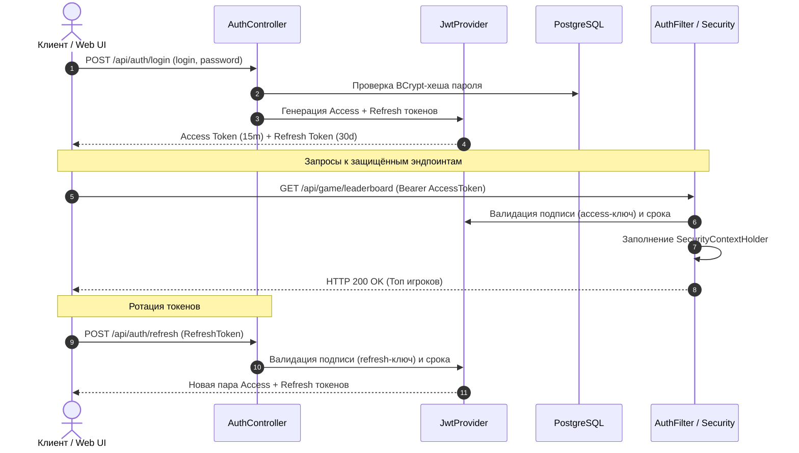
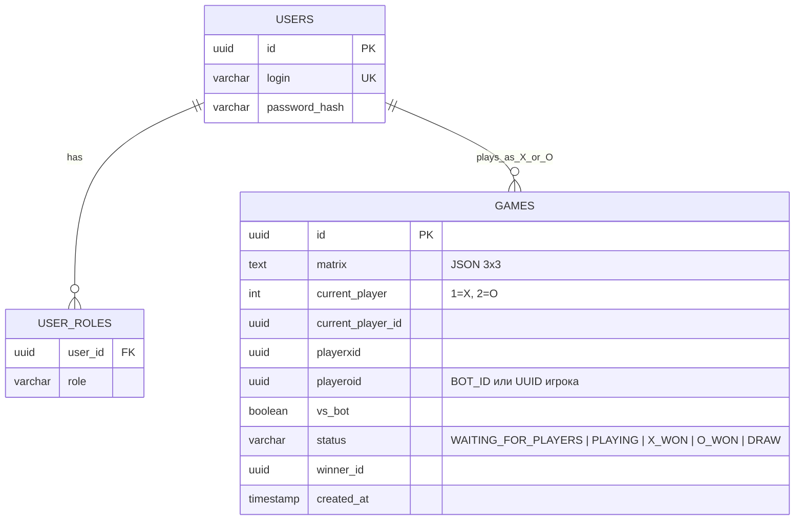

# 🎮 Tic-Tac-Toe Game Service & JWT Auth Backend

[](https://www.oracle.com/java/)
[](https://spring.io/projects/spring-boot)
[](https://spring.io/projects/spring-security)
[](https://www.postgresql.org/)
[](https://www.docker.com/)
[](https://gradle.org/)
[](https://junit.org/junit5/)

RESTful веб-сервис на **Spring Boot 3** для игры в «Крестики-нолики» в двух режимах: против непобедимого алгоритмического ИИ (**MiniMax**) и в **сетевом мультиплеере (PvP)**. Включает **stateless JWT-аутентификацию** (Access + Refresh токены с ротацией), историю матчей, расчёт рейтинга игроков (**Leaderboard**) и встроенный веб-клиент в стиле **1-bit Retro Desktop UI**.

---

## 🛠 Стек технологий

* **Язык**: Java 17
* **Бэкенд**: Spring Boot 3.2.0 (Web, Data JPA, Security, Actuator)
* **Безопасность**: Spring Security 6, JJWT 0.12.5 (HMAC-SHA256), BCrypt (cost factor 12)
* **База данных**: PostgreSQL 16 (Docker), Hibernate ORM, кастомный JPA `AttributeConverter`
* **Сборка**: Gradle (Kotlin DSL: `build.gradle.kts`) + Gradle Wrapper
* **Тестирование**: JUnit 5, Mockito (26 юнит-тестов)
* **Инфраструктура**: Docker & Docker Compose
* **Инструменты**: Project Lombok

---

## 🚀 Ключевые возможности

### 1. Аутентификация и безопасность
* Регистрация с валидацией входных данных (логин 3–64 символа, пароль от 6 символов) и хешированием паролей через `BCryptPasswordEncoder(12)`.
* Раздельные криптографические ключи подписи для **Access** (15 мин) и **Refresh** (30 дней) токенов.
* Обновление только Access-токена (`POST /api/auth/token`) и полная ротация пары токенов (`POST /api/auth/refresh`).
* Кастомный сервлет-фильтр `AuthFilter` (`Authorization: Bearer <token>`) с отключённой двойной регистрацией в контейнере (`FilterRegistrationBean.setEnabled(false)`) и гарантированной очисткой `SecurityContextHolder` в `finally`.
* Ролевая модель доступа (`Role.USER`).

### 2. Игровой движок: ИИ (MiniMax) и сетевой PvP
* **Против компьютера (`vsBot: true`)**: алгоритмический модуль **MiniMax** (`domain/minimax/MiniMax.java`) просчитывает дерево ходов с учётом глубины — выбирает кратчайший путь к победе, блокирует угрозы и никогда не проигрывает.
* **Два игрока по сети (`vsBot: false`)**: создание открытой комнаты (`WAITING_FOR_PLAYERS`), просмотр лобби (`GET /api/game`), подключение второго игрока (`POST /api/game/{id}/join`) и пошаговая проверка очереди хода на сервере.
* Серверная валидация каждого хода: запрет изменения прошлых ходов, пустых ходов, двойных ходов и ходов вне очереди.
* Хранение матрицы игрового поля 3×3 в PostgreSQL через кастомный JPA `AttributeConverter` (`FieldJsonConverter`).

### 3. История матчей и Leaderboard
* **История игр** (`GET /api/game/history` / `/api/game/completed`): возвращает завершённые победы и ничьи текущего игрока в порядке убывания даты.
* **Таблица лидеров** (`GET /api/game/leaderboard?limit=10`): агрегирует все завершённые партии (победы, поражения, ничьи) нативным SQL-запросом и ранжирует топ-N игроков по коэффициенту `winRate`:
  * при наличии поражений или ничьих: `winRate = wins / (losses + draws)`
  * при отсутствии поражений и ничьих: `winRate = wins` (защита от деления на ноль; при равенстве — сортировка по числу побед).

### 4. Встроенный 1-bit Retro Web UI
После запуска сервис отдаёт готовый одностраничный клиент по адресу `http://localhost:8080`:
* Интерактивное поле для игры против ИИ и в PvP-лобби.
* Формы входа и регистрации с хранением JWT в **`sessionStorage`** — удобно открывать две вкладки браузера под разными игроками для проверки мультиплеера.
* Вкладки «Игры», «История игр» и «Таблица лидеров».
* 4 ретро-палитры (`Cream 1-Bit`, `Mac Ч/Б`, `Cyan 1-Bit`, `Amber 1-Bit`) и переключатель звуковых эффектов.

---

## 🔐 Архитектура безопасности (JWT Flow)



---

## 🗄 Схема базы данных



---

## 🏛 Архитектура и структура проекта

Проект построен по **слоистой архитектуре** с выделением доменного слоя и инверсией зависимостей для репозиториев (`domain.repository` → `datasource.repositoryimpl`):

```text
.
├── docker-compose.yml               # PostgreSQL 16 для локального запуска
├── .env.example                     # Шаблон переменных окружения
├── build.gradle.kts                 # Конфигурация сборки Gradle (Kotlin DSL)
├── docs/
│   └── RUN_AND_TEST.md              # Подробные cURL-сценарии (Auth, AI, PvP, Leaderboard)
└── src/
    ├── main/
    │   ├── java/
    │   │   ├── datasource/          # JPA Entities, Repositories, Mappers, FieldJsonConverter
    │   │   ├── di/                  # Конфигурации Spring (SecurityConfig, AppConfig)
    │   │   ├── domain/              # Модели, сервисы, интерфейсы репозиториев, ИИ MiniMax
    │   │   ├── main/                # Точка входа (Application.java)
    │   │   └── web/                 # REST-контроллеры, DTO, JWT Security (JwtProvider, AuthFilter)
    │   └── resources/
    │       ├── application.properties
    │       └── static/index.html    # Встроенный 1-bit Retro Web UI
    └── test/
        └── java/
            ├── domain/minimax/MiniMaxTest.java
            ├── domain/service/impl/AuthServiceImplTest.java
            ├── domain/service/impl/GameServiceImplTest.java
            ├── web/security/JwtProviderTest.java
            └── requests.http        # Коллекция HTTP-запросов для IDE
```

---

## 📡 Спецификация REST API

| Метод | URL | Описание | Доступ |
| :--- | :--- | :--- | :--- |
| `POST` | `/api/auth/register` | Регистрация нового игрока (`login`, `password`) | `Public` |
| `POST` | `/api/auth/login` | Аутентификация, выдача пары Access + Refresh токенов | `Public` |
| `POST` | `/api/auth/token` | Обновление только Access-токена (алиас: `/api/auth/access`) | `Public` |
| `POST` | `/api/auth/refresh` | Ротация токенов (выпуск новых Access и Refresh) | `Public` |
| `GET` | `/api/user/me` | Профиль текущего пользователя (алиасы: `/api/user`, `/api/auth/me`) | `USER` |
| `GET` | `/api/user/{id}` | Профиль игрока по UUID (поддерживает системный `BOT_ID`) | `USER` |
| `POST` | `/api/game` | Создание игры (`{"vsBot": true}` — с ИИ, `{"vsBot": false}` — PvP) | `USER` |
| `GET` | `/api/game` | Список открытых PvP-комнат (`WAITING_FOR_PLAYERS`) | `USER` |
| `GET` | `/api/game/{id}` | Текущее состояние игрового поля и статус матча | `USER` |
| `POST` | `/api/game/{id}/join` | Подключение второго игрока к открытой PvP-комнате | `USER` |
| `POST` | `/api/game/{id}` | Совершение хода (`{"matrix": [[...],[...],[...]]}`) | `USER` |
| `GET` | `/api/game/history` | Завершённые победы и ничьи игрока (алиас: `/api/game/completed`) | `USER` |
| `GET` | `/api/game/leaderboard` | Топ-N игроков по `winRate` (параметры: `?limit=10` или `?n=10`) | `USER` |

<details>
<summary>Примеры JSON-запросов, ответов и кодов состояния</summary>

**Вход (`POST /api/auth/login`)**

Запрос:
```json
{
  "login": "charlie",
  "password": "charliepassword123"
}
```

Ответ (`200 OK`):
```json
{
  "type": "Bearer",
  "accessToken": "eyJhbGciOiJIUzI1Ni...",
  "refreshToken": "eyJhbGciOiJIUzI1Ni..."
}
```

**Ход в игре (`POST /api/game/{id}`)**

Запрос:
```json
{
  "matrix": [
    [0, 0, 0],
    [0, 1, 0],
    [0, 0, 0]
  ]
}
```

Ответ (`200 OK`, бот ответил ноликом `2`):
```json
{
  "uuid": "e2f26102-1f35-46e8-b38a-55ed4f76f0c7",
  "field": [[2, 0, 0], [0, 1, 0], [0, 0, 0]],
  "currentPlayer": 1,
  "status": "PLAYING",
  "winnerId": null,
  "message": "Ход игрока с UUID: 4c946e31-891a-464a-939a-6ca6ea17c6e7",
  "createdAt": "2026-11-04T18:45:12"
}
```

**Таблица лидеров (`GET /api/game/leaderboard?limit=5`)**

Ответ (`200 OK`):
```json
[
  { "uuid": "4c946e31-891a-464a-939a-6ca6ea17c6e7", "login": "charlie", "winRate": 2.0 },
  { "uuid": "8b518c23-281b-419a-941a-7db6fa28c7f8", "login": "diana", "winRate": 0.5 }
]
```

**Основные HTTP-коды ответов:** `200 OK`, `201 Created`, `400 Bad Request` (невалидные данные или некорректный ход), `401 Unauthorized` (отсутствующий/невалидный/просроченный JWT), `404 Not Found` (игра или пользователь не найден), `409 Conflict` (логин уже занят или игра уже завершена).

</details>

---

## ⚙️ Быстрый запуск

### Требования
* **JDK 17+**
* **Docker** и **Docker Compose**

### 1. Запуск PostgreSQL в Docker
```bash
docker compose up -d
```

### 2. Запуск Spring Boot
```bash
./gradlew bootRun
```

После старта приложение и веб-интерфейс доступны по адресу: **`http://localhost:8080`**.

---

## 🔧 Конфигурация (переменные окружения)

Все параметры в `src/main/resources/application.properties` поддерживают переопределение через переменные окружения (пример в [`.env.example`](.env.example)):

| Переменная | По умолчанию (dev) | Описание |
| :--- | :--- | :--- |
| `DB_URL` | `jdbc:postgresql://localhost:5432/tictactoe` | JDBC URL базы PostgreSQL |
| `DB_USER` / `DB_PASSWORD` | `app` / `app` | Учётные данные БД |
| `JPA_DDL_AUTO` | `update` | Режим генерации схемы Hibernate |
| `JPA_SHOW_SQL` | `false` | Логирование SQL-запросов |
| `JWT_ACCESS_SECRET` | dev Base64-ключ | Base64-секрет (≥ 256 бит) для подписи Access-токенов |
| `JWT_REFRESH_SECRET` | dev Base64-ключ | Base64-секрет (≥ 256 бит) для подписи Refresh-токенов |
| `JWT_ACCESS_LIFETIME` | `900000` (15 мин) | Время жизни Access-токена (мс) |
| `JWT_REFRESH_LIFETIME` | `2592000000` (30 дн) | Время жизни Refresh-токена (мс) |

> В продакшен-окружении обязательно задайте собственные криптостойкие ключи `JWT_ACCESS_SECRET` и `JWT_REFRESH_SECRET` (например, `openssl rand -base64 48`).

---

## 🧪 Тестирование

### Автоматические модульные тесты (26 тестов)
* **`MiniMaxTest`** (5 тестов): выбор победного хода, блокировка соперника, предпочтение немедленной победы отложенной вилке, оптимальная защита против угла, поведение на заполненном поле.
* **`JwtProviderTest`** (6 тестов): генерация и валидация Access/Refresh токенов, извлечение claims, взаимное отклонение ключей, отсечение невалидных и просроченных токенов.
* **`GameServiceImplTest`** (8 тестов, Mockito): создание AI/PvP игр, подключение к комнате, запрет игры против себя, автоответ бота, переключение хода в PvP, валидация пустого хода и хода вне очереди.
* **`AuthServiceImplTest`** (7 тестов, Mockito): валидация регистрации, конфликт дубликата логина, проверка пароля, выдача и ротация токенов, отклонение невалидного Refresh-токена.

Запуск всех тестов:
```bash
./gradlew test
```

### Ручное тестирование API
* Готовая коллекция HTTP-запросов для IntelliJ IDEA / VS Code REST Client: [`src/test/java/requests.http`](src/test/java/requests.http).
* Пошаговые сценарии с командами `cURL`: [`docs/RUN_AND_TEST.md`](docs/RUN_AND_TEST.md).
